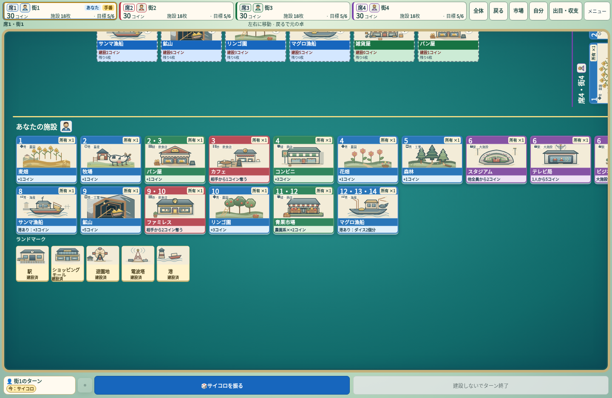
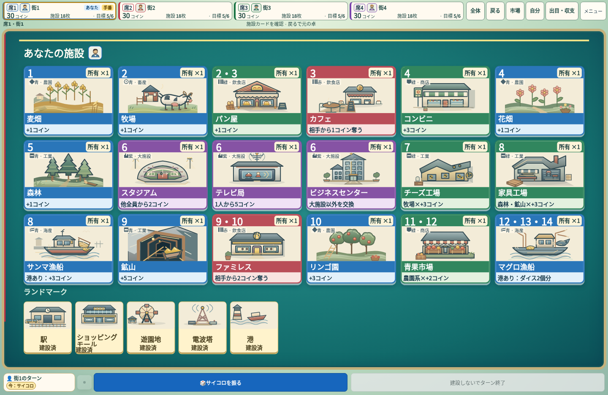

# PR17後の商用品質改善

## Goalと作業方針

最新main `d29b1aa13fd8a2e92c464678608d378ae5bcfe68` を基準とする。四方向の施設カードと中央市場を維持し、ルールの正本・オンライン・CPU・保存・Undo・4テーマを変更しない。作業ブランチ `feat/commercial-quality-followup`。PR作成後もマージは保留する。

実装をまとめてから検証し、ローカルブラウザは1プロセス・1worker、AndroidビルドはGitHub Actionsで実施する。品質判断は実画面・操作を優先し、CI成功を商用品質の証明としない。

## 1. mainの失敗原因

### WebKit 1440px

Release run https://github.com/nao70161994/machikoro/actions/runs/39177770986 の両traceを確認。最終の終盤スクリーンショット／全体復帰付近で45秒に到達した。無限待ち、クリック遮蔽、page error、操作retryは見つからなかった。

1440×936のPCケースにもiPhoneのDPR3・mobile設定が残り、保存PNGは4320×2808。5枚の保存に約8.5秒、操作群に約19〜22秒かかっていた。1440ケースのみDPR1・非mobileのPC設定に修正し、45秒と既存assert・5画像を維持する。320/390/844は既存端末設定を維持する。

変更前の同じテストはローカルChromiumで20.5秒・1/1成功。これはWebKitのローカル再現ではない。trace分析は `artifacts/main-timeout-analysis.txt`、変更前画面は `artifacts/main-1440-reproduction/`。

### Android TWA

最新mainで https://github.com/nao70161994/machikoro/actions/runs/39221089612 を実行し、`minSdkVersion 21 cannot be smaller than version 24 declared in ...androidbrowserhelper:2.7.4` を再現した。CLI1.24.1でもcoreへの依存範囲が浮動しており、実際に利用するcoreとHelperが古い最低SDK設定に一致していなかった。

最低SDKを24（Android7.0）に揃え、CLI・coreを固定して実際のHelper依存を検証する。manifestの強制上書きで古いAndroidを通さない。APKのAndroid5/6対応は終了するが、Web/PWAのソース上の対象はこの変更で狭めない。修正後の実ビルド・エミュレータ検証は後述のrunで成功した。

## 2. 初回の独立画像レビュー

最新main1440の序盤・終盤・正面閲覧、同一runtimeの390/844、公式PV画像を比較。全体4方向の方向性は維持すべき。全体表示の空間は左右のカード列の高さにも制約されるため、単純な全体拡大では解決しない。

優先する具体的な差:

- 奥の所有者名が逆向き、左右が縦向きとなり、HUDとの照合が必要。カードの向きを保ちつつ、所有者名を正立で確認できる補助表示を検討する。
- 終盤の正面閲覧が全体盤面の横長配置をそのまま拡大するため、下部に余白が残り右側のカードが切れる。閲覧中のみ列数を画面へ適応させ、全体復帰で元の配置・視点へ戻す。

HUD・タイトル・勝利・演出には、この静止画レビューから直ちに修正すべき新たな破綻は見つからなかった。演出の時系列と実際のゲーム完走は今回の変更後に改めて確認する。

## 3. 検証記録

以下は時系列の記録。発見した失敗も残し、後の修正・再検証と区別する。最終CI・ゲーム完走の結果はリンク先とPRへ記録する。

## 公式比較の参照

- [Nintendo公式紹介](https://www.nintendo.com/jp/topics/article/1408afb9-9061-4c0c-8a6a-816b5caeccde)
- [開発元作品ページ](https://www.g-rounding.com/workslist/m-machikoro/)
- [公式Steam掲載画像・PV](https://store.steampowered.com/app/1969860/?l=japanese)
- 手元の公式PV参照フレーム: `artifacts/reference-card-table/frames/pv-76s.png`（1:16）。カード卓中央の市場と四方向の所有列、卓外の正立した所有者表示、送金の視線誘導を比較する。画像・キャラクターは製品資産へ転用しない。

このフレームとmain終盤正面閲覧を目視比較すると、本アプリはカードの効果文をその場で読める一方、所有者名が方向に従って回り、正面閲覧で横長の元配置が残る。公式が持つコンパクトな卓と所有者識別の即時性には改善余地がある。公式作品を直接操作しての比較、音響、物理スマートフォンの指操作は未検証であり、PVとブラウザ自動操作の評価と区別する。

### 初回実装と再検証（進行中）

- 所有者ラベルはカードと市場に重ならない卓の空間に配置。画面上で正立させ、スクロール量を補正する。全員表示を置き換えず、正面閲覧では元の見出しを使用する。
- 正面閲覧中だけ選択席の列数を再計算する。閲覧状態を視点履歴に含め、全体／市場／Backでは元の配置を復元する。
- 既存23操作テストの一括実行を開始したが、最初の320pxでBack倍率が0.486→0.483になる回帰を検出したため停止。期待値を緩めず製品コードの原因を調査する。
- 320pxの初回画像では、4席名が正立し施設・市場と重ならないことを目視確認。これは終盤・他幅の確認を代替しない。

Back回帰の原因は旧パネル用selectedスタイルが残り、選択した席のプレイヤーアイコンが25pxから32pxへ変わっていたこと。headerが28→32px、ownerが177→181pxになり、閲覧で全体の外形も変わっていた。カード卓内だけアイコン寸法を統一し、選択で盤面寸法を変えないように修正。320px本体ケースの厳密な倍率・復帰assertは期待値変更なしで成功した。記録: `artifacts/reading-back-diagnose.json`。

### TWA 修正後の実ビルド

https://github.com/nao70161994/machikoro/actions/runs/39222778029 （commit `6ef81389`）で共通installer、APK生成、Android emulator smokeが成功。最新mainの再現失敗→原因修正→同workflow成功まで確認できた。署名配布・ストア公開は行っていない。

### 初回の画像再レビュー

320/390/844/1440の終盤と正面閲覧を別担当が目視。PCは18施設+5ランドマークを比較でき、右見切れ・他席の端の混入・過大な下余白が解消。390は2列、844は5列で横移動を減らせた。四方向の全体配置とカードアートは維持している。

再レビューで844終盤の補助所有者ラベルが空間判定により全て非表示になる点を発見。安全な空白の候補位置と短いラベルを増やし、カードを覆わず所有者を読めるよう追加修正する。

操作23件は22件成功、全38施設を所有した状態で画面サイズを変えた際のカード位置維持1件が失敗。倍率や位置の期待値は緩和せず原因調査・修正する。

## 改善前後の画像（終盤の明示fixture）

PC正面閲覧。ゲーム完走の自然な状態とは別の、18種類＋5ランドマークの比較fixture。

| 変更前（最新main） | 変更後 |
| --- | --- |
|  |  |

| 画面 | 全体俯瞰 | 正面閲覧 |
| --- | --- | --- |
| 320px | [画像](design-review/2026-10-19-quality-followup/after-320-late.png) | [画像](design-review/2026-10-19-quality-followup/after-320-late-readable.png) |
| 390px | [画像](design-review/2026-10-19-quality-followup/after-390-late.png) | [画像](design-review/2026-10-19-quality-followup/after-390-late-readable.png) |
| 844×390px | [画像](design-review/2026-10-19-quality-followup/after-844-late.png) | [画像](design-review/2026-10-19-quality-followup/after-844-late-readable.png) |
| 1440px | [画像](design-review/2026-10-19-quality-followup/after-1440-late.png) | [画像](design-review/2026-10-19-quality-followup/after-1440-late-readable.png) |

画像は最終runtime `9e76a57a` をローカルChromiumで撮影。物理スマートフォンによる指操作の確認ではない。

画面回転の回帰も修正。viewportの可視中心を保存する箇所だけ4pxの枠線を加えておらず、2列の中央に近い左右のカードを取り違えていた。内側領域の座標へ統一し、既存の同一カード中心2px以内・倍率・向き・ゲーム状態不変のassertを維持した。38施設の4画面幅対象は1/1成功、28.7秒。記録 `artifacts/reading-resize-diagnose.json`、変更後 `artifacts/reading-resize-anchor-fix/`。

### ローカル最終確認

- `npm test` 成功（exit 0）。
- `npm run test:types` 成功。ブラウザ終了後に単独で実行。
- 編集3モジュールのESLint・node構文、SW構文、`git diff --check` 成功。
- `npm run test:pwa` 成功。故意のcache put失敗などを注入するケースの警告は期待されたもの。
- 元の45秒制限で320/390/844/1440を再実行。844のラベルで枠線と内側clipの座標差による小さな被覆を検出し、内側座標へ統一して再実行成功（19.6秒）。4ラベルすべて表示・カードと市場に非重なり・枠内に全体が収まることをassertした。PC側もラベル4枚と非重なりを確認。
- 倍率やカード位置の許容緩和、重要assertの削除は行っていない。

### GitHubでの最終画面・完走確認

runtime commit `9e76a57a` をPushし、https://github.com/nao70161994/machikoro/actions/runs/39224594941 で候補画像生成と縦横の実UI操作ゲームを実施。4画面幅のWebKit候補画像は目視確認して採用し、他テーマ12枚のbyte一致を確認した。16画面の回帰比較を維持する。ゲーム完走と最終CIの結果は、このrunとPRに記録する。

独立再レビューの最終判定：修正後844は4枚の席名がそれぞれのカード群の内側に一周して並び、カード・市場の遮蔽なし。前回のラベル非表示の指摘は解消し、採用可。PCの正面閲覧改善も採用可。小画面の終盤俯瞰で細かな文字を読むには正面閲覧が必要という制約は残る。補助名札は識別表示で、正面閲覧の操作入口は44pxのHUDと実カード選択を維持する。

## 公式との差・評価の限界

- 終盤の全体俯瞰は色・出目の分布と育ち具合を比較する表示であり、320/390縦や844横で全員の細かな名称・効果文を常時読めるわけではない。HUDで席を選び、読みやすい正面表示から1回のBackで元の卓へ戻れる構成で補う。
- 320縦で18種類を読むと縦スクロールが長い。読めるカードを保つための制約であり、全体表示への復帰は固定HUDで維持する。5〜10人は全員・市場の適応と状態不変を検証するが、2〜4人と同じカードの大きさは保証しない。
- 公式PVは横画面が主であり、320縦の直接の品質比較には画面条件の差がある。本アプリ独自の2Dカードアートは維持しており、公式のキャラクター・卓面・画像は転用しない。
- 公式作品を直接操作しての並行比較、実機の指操作・音響、初見ユーザー評価は未実施。商用同等という主観的な品質を完全に証明したとは扱わない。静止画の採用判定、ブラウザ自動操作による完走、実機評価を区別する。
