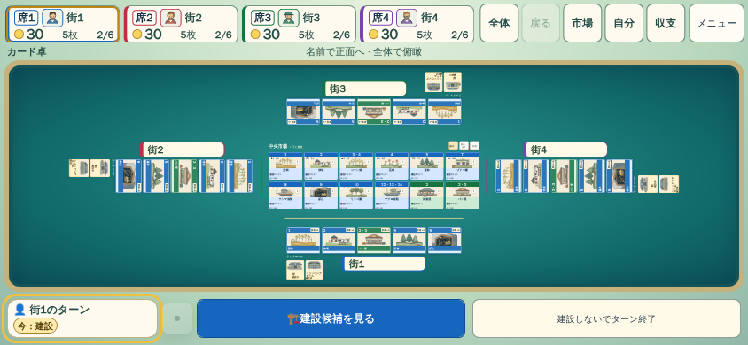
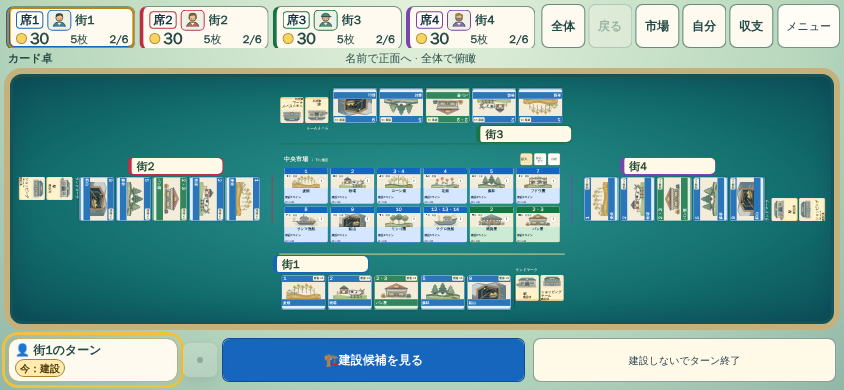

# 四方向卓の中盤ランドマーク配置

## 対象と根拠

PR #19の98addf35を比較元とし、四方向の所有施設と中央市場を維持する。844×390では上下の完成ランドマークが施設の下に並ぶことで卓全体の高さを消費していた。既存の2人卓用の横並び描画を再利用し、上下のランドマークを施設の横へ移す候補を評価した。

候補は横長4人卓の全体表示だけを対象とする。既存の交差/風車配置の実寸スコアと比較し、カード倍率が15%以上改善するときだけ採用する。左右席、縦持ち、正面閲覧の配置は維持する。列数候補の再探索は追加せず、選択済み列数で上下2席の実寸を追加測定する。ゲームルールや保存状態を変更しない。

## 同一状態の画像比較

[WebKit A/B実行](https://github.com/nao70161994/machikoro/actions/runs/41484934106)は固定fixture、Reduced Motion、1 contextずつの12条件。比較元layout JSのみを差し替え、それ以外のソース・状態・端末条件は同じ。実ゲーム進行や物理端末検証とは区別する。

|条件|変更前→変更後の施設カード長辺|配置差|
|---|---|---|
|844序盤|49.63→49.63px|画像完全一致|
|844中盤（5施設・完成2件/人）|37.95→44.18px（16.4%増）|上下の完成ランドマークを横へ移動|
|844終盤（18施設・完成5件/人）|33.54→33.54px|風車配置・画像完全一致|
|1440序盤|154.98→154.98px|画像完全一致|
|1440中盤|106.67→106.67px|画像完全一致|
|1440終盤|83.51→83.51px|画像完全一致|

[実測JSON](assets/nightly-quality/four-seat-rail-comparison.json)。各条件で4人分の所有施設・建設済ランドマークと中央市場の包含、グループ非重複、pageErrors=0、正本不変を確認した。残り5条件の画素同一性もPNG復号後に確認した。画像基準や許容差は更新していない。

独立レビューは原寸画像とソースを確認し採用を支持。上下のランドマークと施設の対応、市場の存在感、余白の改善を確認した。レビュー担当はブラウザ実行を行っていない。

## 操作と処理負荷

[閲覧・市場往復](https://github.com/nao70161994/machikoro/actions/runs/41486566251)で、相手の正面閲覧→復帰、市場→専用市場→閉じる→復帰を通常clickで確認。倍率・角度・配置key・ゲーム正本を復元した。変更前後ともpageErrors=0。

同実行の合成resizeはレイアウトcallbackを発火せず、処理負荷の証拠には使えない。初期callbackには変更前1msに対し候補84〜90msの計測があり、無条件に高速化したとは評価しない。[実幅844→845→844の追加観測](https://github.com/nao70161994/machikoro/actions/runs/41487916802)では、変更前183/97/99/102ms、候補225/126/133/130ms。変更先は毎回寸法測定cacheを更新する条件で、候補は約30msの追加負荷があった。通常閲覧・市場往復の状態とカメラ復元は両方成功したが、滑らかさの改善を証明していない。カード倍率の改善と再配置負荷のトレードオフがあるため、PR採用前の性能判断事項として残す。

## 残る差

44pxの全景カードですべての細字を読むことはできず、正面閲覧が必要。終盤の全景カード幅は今回改善していない。公式作品の大きな主役カード、卓の光・奥行き、連鎖とプレイヤー反応の一体感との差も残る。本変更だけで商用品質やGoal達成とは判断しない。旧バージョンの実UI完走を本候補の完走証拠として扱わない。

## 採用判定と重点回帰

[df3b5dfcの重点WebKit](https://github.com/nao70161994/machikoro/actions/runs/41488463077)は12件すべて初回成功、retry0、3.1分。追加ケースはランドマーク各席2件/合計8件の包含も独立レビュー指摘に基づき確認する。既存の発動、390/1440建設、市場往復、購入とUndo、狭幅操作、HUD識別のassertを維持した。

実幅変更の[生計測](assets/nightly-quality/four-seat-rail-resize.json)が示す追加負荷は受け入れ、16.4%の表示改善を採用する。レイアウト再計算の計測であり、毎アニメーションフレームの追加負荷と同一視しない。一方、再配置自体が高速化したとは主張しない。通常Release・16画面・全Nightlyと候補版の実UI対局は、採用後の同一版で確認する。
