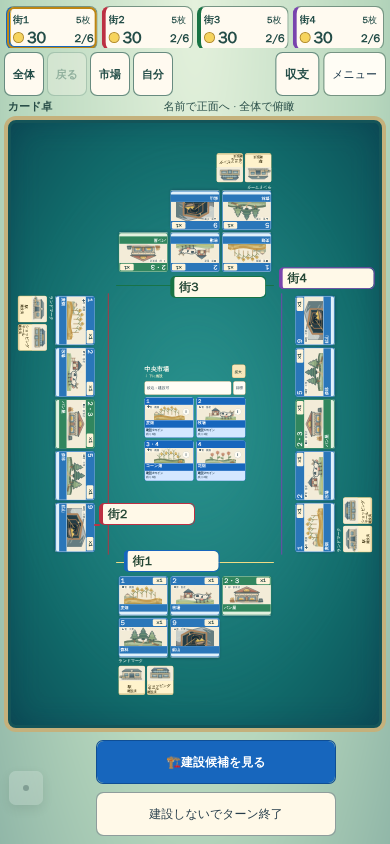
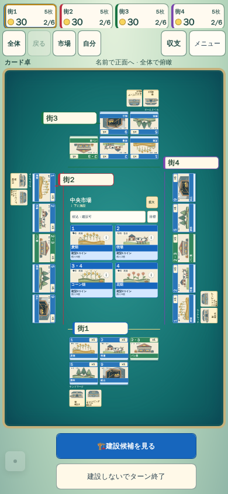
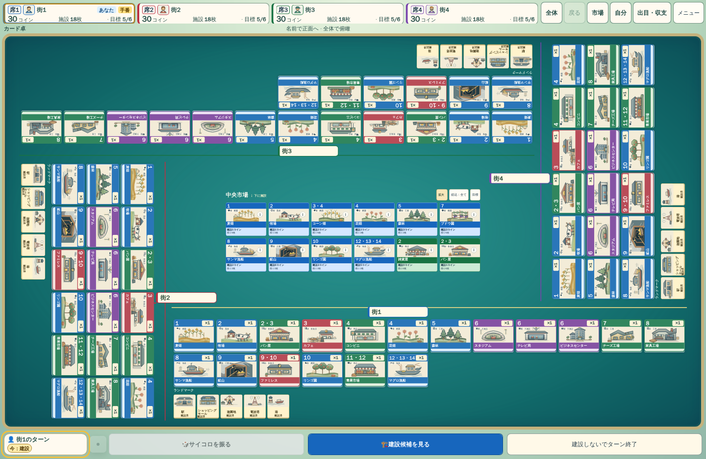
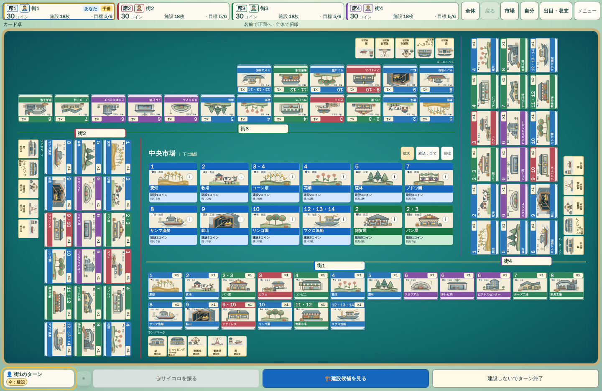

# 中央の余白を使う市場拡大候補（採用判定前）

P0のe7a3fe32とは分離した未commit候補。debug/market-room-scale 651c632e、比較run41677302849。primaryのjs/cardTableLayout.js/tests/card-table-layout.test.jsに候補が残る。

所有者配置とworld寸法の確定後、crossのmiddleWidth/Heightまたはpinwheelのhole内だけで市場をmax1.5倍へ拡大する。市場の中央点、所有者の矩形・4方向の角度・カード寸法、卓全体のfit倍率は変えない。市場が中央holeと同寸なら1、reading/市場dialog中/5人以上も1。geometry keyは倍率を含む。縮小はしない。DOM測定はnative offsetWidth/Heightを使い、transformを寸法cacheへ混ぜない。

既存revealInScrollportはnative座標同士、visibleMarketOrigin/Camera.focusMarketはscreen bounds同士なので、共通scaleの補正は不要。実ブラウザの市場表示・復帰・出目の自動scroll等で別途確認する。

純粋幾何testは上限・幅/高さの制約・余白不足・不正値・入力不変を確認して成功。これは見やすさやブラウザ互換性の証拠ではない。

native A/Bはf8e7a170のlayoutソースと候補だけを差し替え、他の描画/ルール/fixtureを共通化。320/390/844/1440の4人序盤・中盤・終盤で、所有カード/ランドマークと市場の非交差・viewport内・正本不変を検査し、画像と寸法を保存する。390終盤pinwheelではhole幅が市場幅と等しく、改善しない可能性を明記する。その場合は終盤課題を解決したと扱わない。

候補採用前に画像を目視レビューし、倍率だけで改善と判定しない。公開PRのRelease/Nightlyの結果とdebug比較結果を混同しない。

## 最初の比較結果（651c632e）

run41677302849は4サイズ×序盤/中盤/終盤×旧/候補の24画面を完了。全sceneでworld寸法・全体倍率・所有者矩形・ゲーム正本が同一、施設/市場の交差やviewport外はなし。市場倍率が増えたのは320中盤1.274倍、390中盤1.488倍、1440終盤1.403倍。他9sceneは1倍。集計: assets/nightly-quality/market-room-651-summary.json。

|画面|改善前|候補|
|---|---|---|
|390中盤|||
|1440終盤|||

独立画像レビューは市場の存在感・文字/価格/在庫の判読性の改善を確認し採用を支持。新しい重大な重なりは見つからなかった。ただし320中盤で所有者名が2人分しか出ない既存の問題を確認。名前が短くても96pxの最小幅を確保していたため、既存のcollision guardは保ったまま、自然な実名幅（min44px）と長名用96px fallbackを使う候補を追加した。文字サイズを縮めない。

複合候補03851eef / run41680042601では旧版Field/Layoutと候補を同一fixtureで比較し、候補の全sceneで4人分の名前が完全表示されることも検査する。市場の拡大/購入/Undo/戻ると、新しい320/390中盤の所属名操作テストをまとめて実行中。まだ採用完了ではない。

## 複合候補の採用判定

03851eef / run41680042601が成功。24画面すべてでworld・カメラ倍率・所有カード座標・ゲーム正本は旧版と同一。全12sceneで4人分の短い名前を全文表示（320序盤0→4、中盤2→4、他10scene4→4）。購入/Undo・市場拡大・視点復帰・出目/枚数・狭幅操作・短名所有者の9caseも初回成功、retry0。集計はassets/nightly-quality/market-room-labels-038-summary.json。

rootの320操作画像目視でも全名が施設群へ対応し、新たな重なりは見つからなかった。独立ソースレビューは市場拡大とmin44短名を採用可、独立画像レビューも市場の改善を支持。短名のmax176/200・長名96fallback・重複名識別・nearest-own/collision制約は保持する。文字サイズやタップ領域を縮めていない。

この比較・9操作を根拠に製品へ採用する。既存16基準画像の成否は別途判定し、差分を目視せず更新しない。4モード/オンライン/CPU/保存/Undo/PWAの全件検証と、採用後のUI実対局は一括Push後に実施する。スマホ終盤の市場サイズと小さいカード全般、演出・公式品質との差をこの改善で解消したとは扱わない。

追加の独立画像レビューは320/390の操作画像で、4名が全文表示され各施設群を識別でき、新たなカード/市場/操作の重なりがないことを確認した。街1の名前は末尾側だが誤所属を招く位置ではないと評価された。
