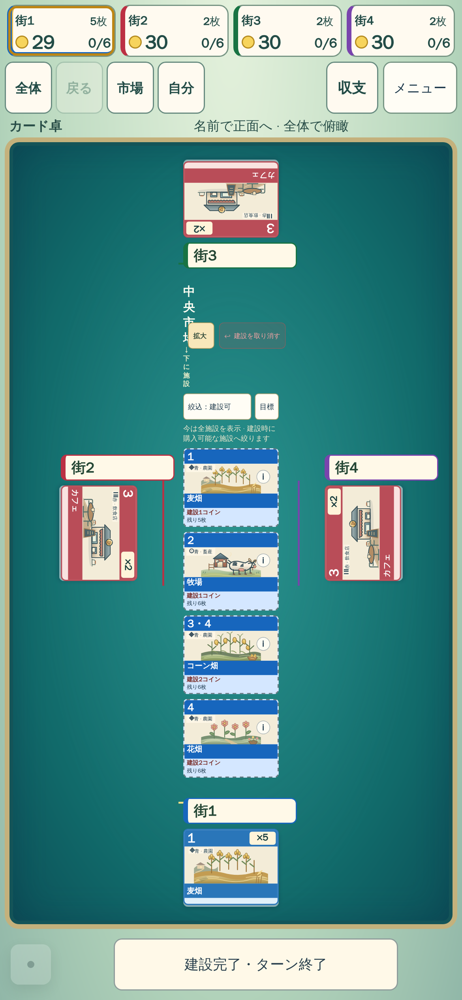
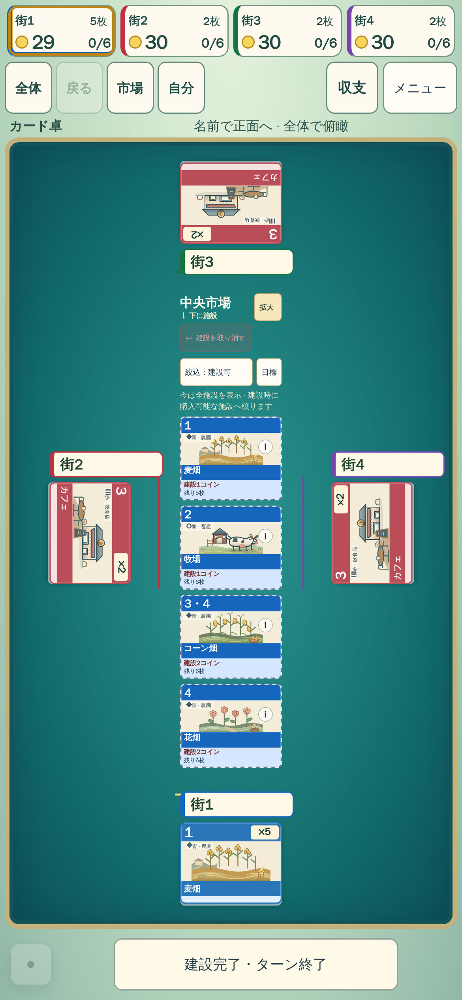

# 購入後の狭幅中央市場と視点復帰

## 製品修正と証拠

12aのRelease41612931677とNightly41613208404で再現した、390px購入後の1列市場の重なりを修正した。追加Undoが全文で表示される一方、headerのnowrapと見出しのmin-width:0がタイトルを圧縮していた。3列市場の問題という初期仮説は実画像で棄却した。

1/2列市場だけheaderをwrap、見出し最小80pxへ変更。見出しは横書き、収まらないUndoは次段へ移し、全文・操作44px・実寸での配置探索を維持する。比較画像は同じ390×844・4人・麦畑購入後の制御fixtureで、自然対局ではない。

|修正前12a|修正後f601|
|---|---|
|||

独立画像レビューで市場の全文/操作/案内/施設4枚が収まり、新たな切れ・重なり・所属の退行なしと承認。Undo文字色の弱さは既存課題として残る。基準画像や許容値は変更していない。

購入後の相手カード閲覧へ戻るy差は、semantic anchor復元の最近傍pixel化で1.083550→0.083550px。通常pan/zoomと保存済み整数scrollの直接復元を維持。元の1px判定で390/844とも成功した。

## 検証を区別する

f601の重点19は16成功/3失敗。市場見出しと視点復帰の元判定は成功。追加Undo2件は確認modal承認を省略したテスト手順ミスであり、d225では通常の確認クリックを補完した。もう1件の1440建設は2RAF間約1191ms停滞の再発で、未解決。1500ms/480msの条件を延長していない。

f601のRelease/Nightly失敗は追加Undoの同2件、16画面は成功。d225の通常Release41625435478（卓37件/勝利4件、retry0）と16画面41625435523は成功。全Nightly41625594178は夕暮れランドマーク詳細1件が初回modal hidden→retry成功となり、厳密な安定性判定で失敗した。P0完了・Goal達成とはしない。

狭い4人縦画面の中央市場の絶対的な小ささ、左席名の対応、公式作品との光・奥行き・連鎖演出の差は、このヘッダー修正だけでは解消しない。実UI4対局の生集計は[別記](assets/nightly-quality/ui-12a-summary.json)。物理端末/人間による体感評価ではない。

## 描画境界候補を不採用

別ブランチ6a30511fでviewportだけcontain:paint/isolationを追加し、同じ元1440建設ケース・assert・演出480ms・retries0をbaseline/candidate各3回で比較した（41626369905）。通常ゲートやPR製品コードは変更していない。

両方3/3成功だが、最大RAF観測間隔は元1185/977/947ms、候補955/933/942msで、約1秒の停滞が残った。実行順序/温まりの影響も排除できず、根本修復の証拠にならないため不採用。viewport内fixed/popoverの包含・clipへの副作用確認も未実施で、この限定比較を全体互換保証にしない。[生フレーム集計](assets/nightly-quality/bounded-paint-6a-summary.json)。巨大worldをGPU層へ昇格させる変更は行っていない。

## 次のP0調査：夕暮れランドマーク詳細

d225のNightly shard6（125882223385）で`visual-art-review.spec.js:1013`が初回失敗・再試行成功。traceで駅詳細ボタンがvisible/stable待ち中にdetachされ再取得し、最終入力座標決定〜click完了にも約950msある。失敗時はCPUが先頭席で待機、人間が後方席の手番。quickplayの初手CPU進行と市場再描画の競合が最有力だが、pointerdown/up/clickの到達とmodal開閉記録がなく断定しない。

非compactの`renderBuildMenu`は毎回innerHTMLで全市場を置換し、cardboardの既存DOM保持とは異なる。最小の同一HTML skipだけでは在庫等の変更時に同種競合が残る。次は通常のmouse down中に実購入/再描画→mouse upする制御fixtureで旧挙動を再現し、既存のカード卓DOM保持を他モードでも共有できるか検討する。CPU書換え/強制クリック/visible assert削除/timeout緩和で旧失敗を隠さない。現時点では仮説と検証計画であり修正済みではない。
