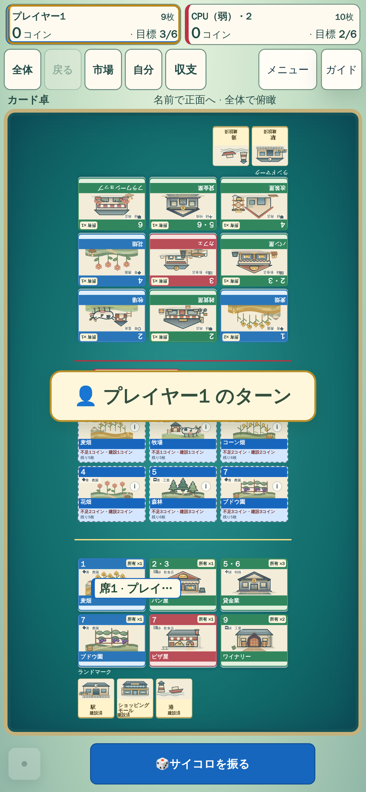
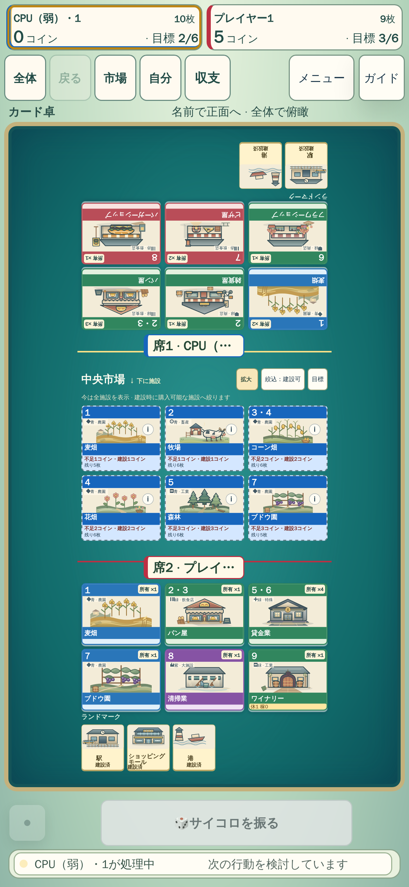
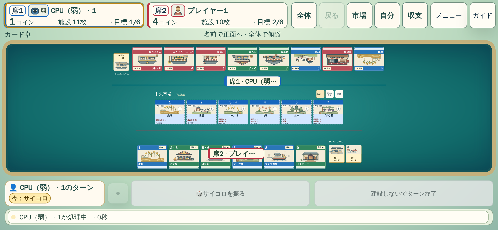
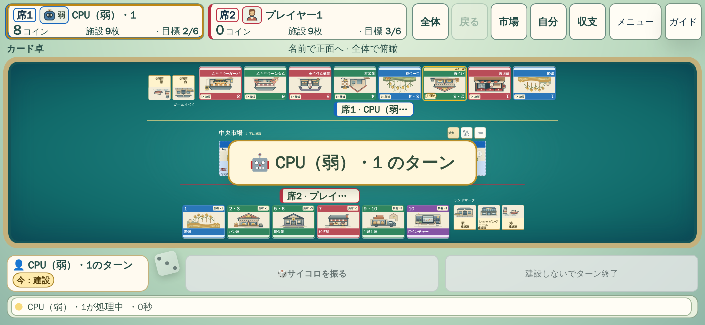
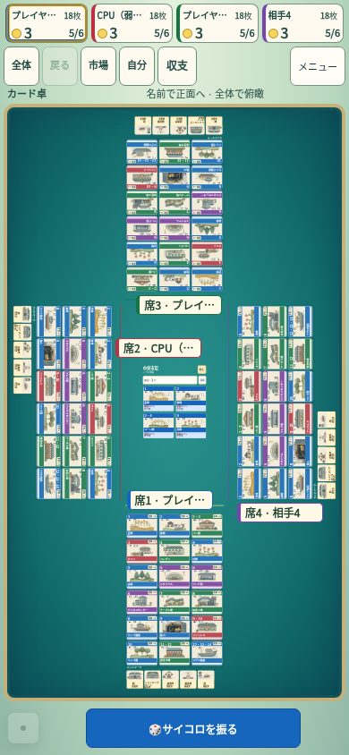
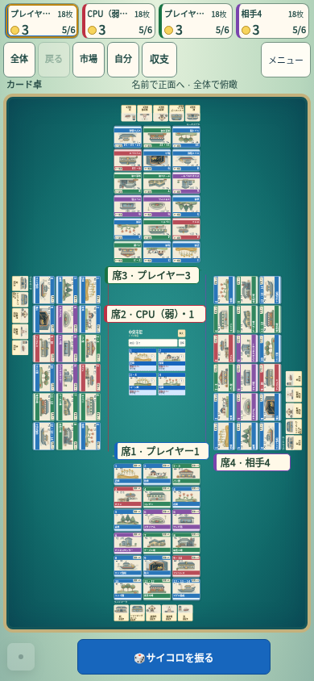
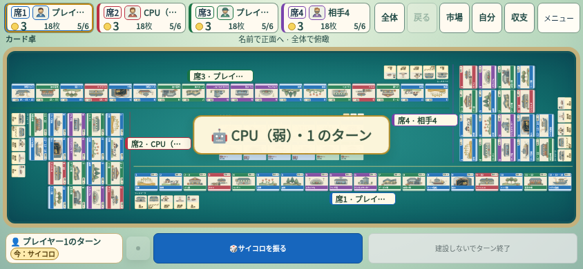
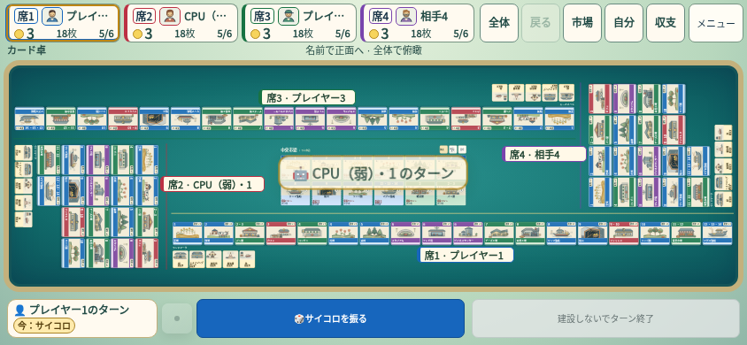

# 品質改善の最新確認状況

対象: PR #19 / `feat/nightly-table-quality`。mainへのマージは保留。

このページは最新状況の要約です。経緯・原因分類・画像・独立レビューは
[調査記録](nightly-table-quality-2026-10-23.md)を参照してください。
テスト成功と商用品質への到達は別に評価します。

## 現在の確認対象

固定環境の最新完走対象は `437e65a9`。市場closeの同期化まで含む。Nightlyは全345件を収集し完走したが、初回343成功・1再試行成功・1許可済skipのため、安定成功とはまだ判定しない。

| 対象 | 根拠 | 状況 |
| --- | --- | --- |
| PR | #19 / feat/nightly-table-quality | Draft、マージ保留 |
| 全Nightly | [40887636045](https://github.com/nao70161994/machikoro/actions/runs/40887636045) | 345件の網羅性確認成功。6分割の各ブラウザjobは8.9〜13.8分。SW二世代テストのみ再試行成功 |
| 通常Release | [40887602108](https://github.com/nao70161994/machikoro/actions/runs/40887602108) | 成功 |
| 16画面・操作 | [40887602130](https://github.com/nao70161994/machikoro/actions/runs/40887602130) | 成功 |
| 建設・市場再表示 | [40887631096](https://github.com/nao70161994/machikoro/actions/runs/40887631096) | 固定WebKit、7件retry0成功 |
| 通常速度の縦横実UI完走 | [40885367734](https://github.com/nao70161994/machikoro/actions/runs/40885367734) | eb289904、CPU1500ms。390縦70ターン/182actions、844横71ターン/184actions、双方errorsなし。最新変更の代替証拠ではない |

### 次の候補で修正・確認中

- **SWテストの観測競合**: タイトル復帰後の `waitForLoadState` が旧documentのloadで解決し、v2確認が実reloadと競合していた。確認クリック前に実navigation待機を登録する。v2/cache/controller/errorの検証は維持し、例外の握り潰し・時間延長は行わない。context closeの失敗時も世代serverを停止する。
- **横持ちCPU待機**: 通常のローカルCPU通知を無効な操作欄へ移す。有効操作・復旧・接続通知は通常配置へ戻す。非表示ボタンのnative hidden属性と既存displayを同期する。
- **長い手番名**: 横持ちCPU待機の固定高フッターだけ、名前の折り返しでフェーズを押し出さないようにする。人間手番の全文表示は維持。全文は既存title/ariaでも確認できる。

[改善前](assets/nightly-quality/cpu-inline-844-before.png) / [改善後](assets/nightly-quality/cpu-inline-844-after.png) / [測定条件](assets/nightly-quality/cpu-inline-844-comparison.json)。844×390の同条件4CPU序盤fixtureで盤面高218→250px、双方撮影中の正本不変。比較は437e65a9のCSS/mainと候補の差。CPU予定を停止した表示fixtureであり、実対局・物理端末確認ではない。

ローカル確認: ui/main単体、main/UI型、変更JSのESLint成功。ブラウザ5件中、SW・CPU・終盤ラベル2幅は成功し、人間手番名1件の回帰を検出。変更を横持ちCPUだけへ限定し、CPU・人間手番名2件を再実行して双方成功。assert・時間・許容値は変更していない。ローカルブラウザはTermux Chromiumであり、固定WebKitのCI結果とは区別する。

独立レビューは比較前後PNGを目視しCPU通知の配置を採用可と評価。有効操作と復旧通知の退避条件も確認。終盤・native WebKitは別証拠が必要。通常速度の実UI画像では縦持ち終盤の所有者ラベルとカード群の対応、勝利画面の長いランドマーク名の組版に改善余地が残る。横持ち上端の切れという初見の指摘は原寸再確認で撤回され、製品不具合として扱わない。

### 縦持ち2人戦の所属ラベル（次候補）

通常速度の実UI画像で、施設群末尾の空きへ所有者名が配置される問題を確認。非対称な終盤の表示fixtureで再現した。縦持ち2人戦の見出し帯を28→48pxへ広げ、施設群と市場の境界に名前を置く余地を確保する。四方向配置・カード群・正本・ラベルの衝突判定は変更しない。

- 40px案はラベル移動に効かず、64px案は48pxと同効果でカード縮小が大きいため不採用。
- 390pxの俯瞰倍率は0.360→0.352（約2.2%減）。独立目視レビューは所属識別の改善が上回ると評価。任意の所有構成で常に先頭配置される保証とはしない。
- 320/390pxの非対称終盤で、市場側へのラベル配置・全文・卓の収容・正本不変を確認済み。4人戦390/844pxの全文と6〜9人全卓を含むlocal4ケース成功（38秒）。独立目視でも320/390に重なり・切れの重大退行なし。静的資産確認と構文確認成功。347件、6分割58/58/58/58/58/57。横持ちと3人以上にはこの見出し寸法変更を適用しない。
- [変更前](assets/nightly-quality/owner-band-390-before.png) / [変更後](assets/nightly-quality/owner-band-390-after.png) / [測定条件](assets/nightly-quality/owner-band-390-comparison.json)。実対局写真とcontrolled fixtureは区別する。

## 今回の修正

1. 通知で盤面が縮むとき、古い倍率が残る時差を解消。CPU状況表示と同じ処理内で俯瞰をfitする。正面閲覧・自由移動には介入しない。
2. 48pxの操作帯から44pxのボタン群が1pxはみ出す配置を修正。タップ対象とsafe-areaは維持。
3. カメラのmatrix適用後に所有者ラベルを配置。旧位置のラベルが施設アートを覆う問題に対応し、予約済みの重複更新を取り消す。
4. 送金の全体easeがfadeを前倒しする問題を修正。出現・移動・消失を区間ごとの加減速にし、600/900msの寿命は維持。
5. 市場往復と4幅の建設を独立ケースへ分割。既存の判定・通常クリックを維持し、時間制限は延長しない。

## 失敗の分類

- **製品の不具合**: 通知と倍率の時差、所有者ラベルとカードの重なり、操作帯の越境、収支・休業表示の競合、HUD名、開示の排他、nativeスクロールとカメラの座標差等。
- **旧fixture・期待値**: 5/10人表示、現在のHUD52px、非表示の目標へのfocus、CPU設定とCPUオブジェクトの不一致、現在の所有者名と旧「あなた」表示等。
- **観測・実行負荷**: 複数の実UI往復を45秒に集中、長いファイル単位のshard偏り、演出の観測を開始する前の別操作等。動画とtrace画像の除外だけでは解消しなかったため、それだけを原因として扱わない。
- **前回Nightly（012a3344）で成功**: 市場10往復、建設4幅、送金のopacity検証。480ms寿命・1500ms観測期限・動作中の実フレーム検証は維持。
- **前回Nightly（012a3344）で残った問題**: Reduced Motion設定を素早く戻した際のcleanup、1000枚town境界の逐次確認による45秒超過、CPU状態の一部だけを書き換えたfixture、レスポンシブDOM差替え前のスタイル採取。修正済みで固定環境の再確認中。

assert削除・差分許容値の緩和・強制クリックで失敗を隠す対応は行っていない。
スクリーンショットは、固定環境の候補を独立目視確認したものだけ採用。

## 実プレイと見た目

以下は過去 `012a3344` の実UI完走記録。最新の完走結果は上表と末尾の追記を参照。縦は55ターン/138操作/221クリック/206702msで完走しpageErrors0。
縦画像の独立レビューでは、中盤の所有者ラベル重なりとランドマーク切れの解消を確認。
撮影前後と8RAFすべて範囲外要素0、各時点の倍率とfit値が一致した。
横は77ターン/213操作/320クリック/428362msで完走しpageErrors0。画像の独立レビューでも
ラベルの重なりと実カード・ランドマークの切れは確認されなかった。
横の撮影直後とRAF2には透明な所有者パネル箱だけが上へ出る記録があり、全時点で全矩形が収まるとは報告しない。
実カード・ランドマークは収まり、RAF3〜8ではパネル箱を含め範囲外0。

### 所有者ラベルの改善前後

どちらも実際のゲーム進行で撮影した画像。別対局のため、カード構成と手番は異なる。
固定fixtureの画素差比較としては扱わず、ラベルがアートを覆う旧問題の可視例と修正後の例を示す。

| 修正前 `7d63632c` | 修正後 `012a3344` |
| --- | --- |
|  |  |
|  |  |

320/390px縦、844px横、1440px PC、2〜10人の検証はfixtureによる表示・操作確認と、
実ゲーム進行による完走確認を区別する。全条件で人間が実機を操作したという意味ではない。
物理スマートフォンでの確認は未実施。

## 公式作品との比較

[公式サイト](https://m-machikoro.g-rounding.com/)と公式PVの実プレイ区間を参照済み。
四方向の所有カードと中央市場を共通卓に置く構成は維持し、景観中心には戻していない。
独自の施設アートを使い、公式の画像・キャラクターは製品へ複製していない。

残る品質差は、大型カード・卓面の光・プレイヤー反応が同期する演出の一体感、
縦持ち全景の小字、横持ち2人戦の空間の使い方等。
正面閲覧と拡大で読めることだけで、全景の読みやすさまで同等と評価しない。

## 完了前に必要な確認

- 最新製品で通常ReleaseとNightly全体が成功し、再試行だけに依存していないこと。
- 最新の画像レビューでラベル重なりは解消を確認済み。追加修正で悪化していないこと。
- CIの演出観測結果を確認し、失敗時はフレーム記録から製品とテストの原因を分けること。
- 最終画像・操作結果・互換性の根拠と、未検証事項を報告すること。

Goalは継続中。PRを完成扱いにせず、明示指示なしにmainへマージしない。

## 追加修正（43614a06のCI調査後）

- 建設1440pxの記録では、盤面復帰後のRAF待ちにより飛行開始が観測期限1500msを超えた。同期済みの最終座標を直ちに使用し、到着アニメーションを付ける前の矩形へ飛行させる。480msの寿命と既存の実フレーム判定は維持。
- 自分で行った瞬時スクロールの遅延イベントは、新しい飛行を取り消さない。実際の座標変更・手動操作では従来どおり取り消す。
- 通常の盤面・広場操作・終了確認fixtureではSW更新を分離。更新通知ありの建設320pxと終了確認2件を明示的に追加し、実クリックと状態検証を維持。
- 広場fixtureは初期描画後に実際の市場ボタンで移動する。描画前のプログラム移動が初期視点設定に上書きされる競合を解消。
- ローカルChromiumで建設5件・終了確認4件が成功。広場2件はfixture修正後に17.4秒で成功。型検査・構文・差分検査も成功。固定環境WebKitは別途再確認する。
- 列挙337件、配分57/56/56/56/56/56。元の334件に通知あり3件を追加。追加修正後の実UI完走・独立レビュー・Release/Nightly成功はまだ未確認。

## 画像再レビューからの改善

所属ラベルは文字の実測幅を使って空き領域を探索し、収まらない場合は従来幅へ戻す。
1×1の計測contextを再利用し、カード・ランドマーク・市場との重なり回避を維持する。
横持ちの手番通知は表示時間・操作非遮断を変えず、余白と文字サイズを調整した。

| 変更前 | 変更後 |
| --- | --- |
|  |  |
|  |  |

4人・各18施設種・5ランドマークの同一表示fixture（実対局ではない）。
独立レビューで390/844/1440pxの前後12画像を確認し採用可と評価。
390/844pxの通常名が末尾まで読め、カードとの重なりなし。1440pxは元から読めて変化小。
横持ち通知は約284×56から214×36へ縮小。ただし市場の一部を一時的に覆う点は残る。
フェードの採取時点が異なるため、画像だけでopacityや連続体感の優劣は判定しない。

建設演出は盤面復帰の最初の描画で480msの大半が消費される記録を確認。
新しいレイヤーを停止状態で描画してから時計を開始する修正を検証中。
480msの寿命・1500msの観測期限・60〜400msの動作中フレーム判定は変更しない。

### 実対局画像から追加発見した見切れ

e99の横持ち中盤で、相手席の計測記録は高さ209px・7列のまま、実DOMが高さ341pxへ増えており、
卓内上端を約44px超えていた。撮影前後約829msの記録に残り、約600ms後に8列へ再配置され解消。
これは過去の透明panel箱だけの1px超過とは別の、実カードが切れる不具合である。
個別カード名は当該geometry JSONに含まれず断定しない。
構造変更後にLayoutを同期確定し、それからCameraを更新する修正と、次のRAFを待たず確認する回帰ケースを追加中。
実UIが勝利まで進めたことだけで、全景表示の完成を主張しない。

### 追加修正のローカル確認

- 型検査（4 composition root）、Field/Layoutのtargeted unit、構文・差分確認が成功。
- 名前検証390/844と施設7種→8種のrender直後の非clip・状態不変検証は成功。
- 先行9件では建設5件成功、旧多段overviewの390/844が45秒全体期限に到達（DOM欠落の判定ではない）。名前確認を旧多段ケースから独立した短い2件へ分け、元のシナリオ・assert・45秒は維持した。ローカル失敗を成功に読み替えず、固定環境の全体再実行でも確認する。
- Nightly列挙は340件、配分57/57/57/57/56/56。元337件に名前2件と構造変更直後1件を追加。

追加同期後のローカル関連8件は全成功（1.7分）。名前2件・同task施設追加1件・建設5件。固定環境の再実行結果は別途確認する。

## 元の失敗と検証網羅性の監査

[元3回の23種類の失敗と現在の検証対応](nightly-main-failure-audit.json)を記録した。
行番号の変動を除いて失敗を正規化し、各run・元エラー・製品/fixture分類・検証契約・現在の24ケースへの対応を追跡できる。
これは実行成功の代用ではない。

分割済み市場10ケースは20回のテーマ変更を含むが、同一ページ5連続の検証とは等価でなかった。
詳細10ケースを残した上で、同じページ/対局で5連続の市場拡大・目標・focus・close・表示切替を行う短い専用ケースを復旧。
実クリックと状態不変を維持し、観測だけを集約。ローカルで21.9秒・45秒制限のまま成功（後にタイトルのみ修正）。
新規製品変更はなく、次回Nightlyは341件となる。

## 9c70127bの確定結果

通常Release40808154666、16画像/操作40808154698、実UI40808156172、Nightly40808153550は全体成功。
ただしNightly建設320pxに1件の再試行成功があり、安定成功の完了条件はまだ満たしたとしない。

実UIは縦81ターン/216操作/339クリック/419289ms、横63ターン/145操作/237クリック/370855ms、双方pageErrors0。
独立再レビューで6画像と縦横計20座標sampleを確認。全sample outside=[]、所有者のnative寸法/位置とlayoutKeyの照合mismatch0。
横の7→8列の変化も撮影前後で同期し、旧44px見切れの解消を裏付ける。個別card矩形はJSON未収録で、全進行の毎paintの完全保証とは区別する。

建設の一時的なglow補間を静的にする案はローカルで改善を確認できず撤回（未コミット・未Push）。
実操作320pxのCDP Timelineではclose後のLayout.layout約203msにstyle更新12回、続くpresentPendingBuildCues約133msに11回、Paint約15msを記録。
これはローカルChromiumの1回の記録であり、WebKitの唯一の律速を断定するものではない。
次はレイアウト内のviewport寸法の繰返し読取りを同taskのsnapshotへまとめ、不要なstyle flushを減らす。寿命・観測期限は維持。

viewport寸法snapshot後の同じ320px実操作プロファイルは14.0秒で成功。
close後のLayoutは203.2→196.6ms、pending cueは133.2→126.8msだったが、style更新回数は10/12回のまま。
各1回のローカル計測なので速度差を有意な改善やWebKitのflake解消の証明には使わない。
採用範囲は同じ処理内で不変なviewport値の不要な再読取りを減らす最小変更。
固定環境で341件を再確認し、再試行に依存しないかを引き続き検証する。

## 紙の縁による所有量表現の試案（不採用）

所有×2に1段、×3以上に2段の静的な紙縁をカード内部余白へ描く案を試作した。
同一2人fixture・所有1/2/3/6枚、390/844pxの俯瞰/正面計8画像を独立比較。
寸法・文字・アートへの害はなかったが、844px俯瞰では縁の微差に留まり、
3枚と6枚の差を表せず、発動/休業時との一貫性も弱かった。
所有量の直感的な識別という目的への効果を確認できなかったため、追加属性とCSSを撤回した。
製品・基準画像には採用せず、P2達成の証拠にも数えない。比較用artifactのみ保持する。

## 1fe3cfac の固定環境再検証と残る修正

Nightly 40810424216 は341件を完走したが、337成功・2失敗・1再試行成功・1許可済skipで失敗。
Release 40810420143、16画像/操作40810421171、実UI完走40810427450は成功。
夜間の失敗は同一対局5往復の閉じる直後のfocus観測と、1440px建設flightの開始遅延。320px通知中の建設も再試行となった。
前者は製品の非同期focus復元前にsnapshotしていたため、元の個別ケースと同じretrying toBeFocusedを追加した。assert・45秒上限は維持。
後者は表示領域が660→608→660と変わる際、所有者の実測cacheが毎回失われていた。
各panel最大3件の完全一致contextを保持するLRUへ変更し、非表示の残高/手番ではなく実表示の見出しをkeyにした。
viewport幅高・施設種類数・建設数・見出し全文・body/htmlクラスが異なる場合は別contextとし、従来の形状別実測は維持する。
独立した静的レビューで重大な不整合なし。WeakMap配下の数値寸法Mapで、上限は各panel3context。
flight480ms・1500ms観測期限・動いているframeの検証は変更していない。実ブラウザ再検証中で、WebKit安定化はまだ未確認。

1feの実UI完走：390×844は234操作/349click/最終turn index82/358430ms、844×390は245操作/373click/index92/387130ms。
両方completed=true、pageErrors=[]。中盤・終盤・勝利の6画像を独立目視し重大な表示退行なし。
自動ブラウザによる検証で、物理スマートフォンの確認ではない。商用作品との品質差が解消したという証明にも用いない。

LRU単独のローカル6件は3成功/3失敗（4.0分）。390/1440/320通知中は成功、320/844のflight開始は依然遅い。
5往復はprepare中に45秒上限となり、traceではgoto約23.6秒・初期evaluate約11.3秒を消費し、往復操作まで進まなかった。
LRU単独を建設遅延の解決と扱わない。構文・layout unit・型検査は成功。
続いてfocusCardの正面化で中間matrixのpaint/矩形測定を省き、実カードのnative寸法からfit scaleを算出する変更を検証する。
seatとcameraの回転が相殺する正面閲覧に限定した経路で、最終paint・位置測定・中央へのscrollは維持する。

中間paint省略後、local Chromium retry0で320/844建設flightと同一対局5往復が3/3成功（40.0秒）。
回転カード→正面詳細→俯瞰復帰、全38施設の正面表示、施設追加直後の相手カード見切れの3件も成功（29.1秒）。
320/844建設完了画像を目視し、通知の文字/アートの表示退行なし。カード閲覧中の周辺カードは引き続きpan対象。
端末負荷と初期ロード時間の差があるため、この2実行の所要時間だけで速度改善率を主張しない。
残る判断は固定WebKit環境の全Nightlyで行う。

Camera差分も独立静的レビューで採用可：正面化時の回転相殺、同期reading配置、最終center測定、Back状態を維持。
一時的な到着/hover transformをfit基準へ混ぜず、最終paintでlabel/geometry通知は実行する。
変更後の構文・型検査（main/ui/storage/online composition roots）もすべて成功。

## f253d15d の固定環境結果と建設開始の追加調査

Release40837085876と縦横実UI40837106936は成功。縦390×844は201操作/315click/最終turn index77/479757ms、横844×390は174操作/287click/index70/442203ms。両方completed=true、pageErrors=[]。
Nightlyはshard4の1440pxとshard5の320px更新通知中で建設flightが両attempt失敗。
1440pxはghost生成close+約690ms、RAF観測+1324/+1540msでいずれもpaused/currentTime0。
320通知は+1082/+2354ms、retry+873/+1595msでpaused0。二重RAF開始待ち自体が期限を消費している。
中間paint削減だけでは安定化に不十分だった。fixtureのfocus復元5往復は今回成功。
追加修正ではpause/currentTime0直後のanimation.readyを待って、既存current/identity guard通過時のみplayすること。
readyはpending pauseの完了通知であり、初期ghostの実paint/GPU表示の証明ではない。独立レビューもこの限界を指摘。
ready/finishedのreject処理、Undo/session/hidden/reduced-motionの取消条件、480ms寿命・1500ms観測・60〜400ms実frame検証を維持し、同じ条件で再確認する。

ready方式のlocal5条件はretry0で5/5成功（55.1秒）。実flight frameをclose後320=440.6ms、390=481.7ms、844=523.9ms、1440=597.2ms、320通知=516.3msで観測。
各currentTime66〜83ms、duration480ms、pointer-events none、画面内を既存assertで確認。unit card-board-fieldも成功。
f253実UI6画像とgeometryを独立レビュー：before/after/RAF1〜8すべてoutside0、倍率/fit一致。ラベル被覆/landmark切れ退行なし。
残差は終盤俯瞰小字、手番bannerの一時的な市場遮蔽、モール名末尾の折返し。静止画像で連続flight可視性/音/人間体感は保証しない。

ready方式は構文・関連unit・型検査成功後にコミット。固定WebKitでの再確認は未完了。

## 確定したf253全体結果とabc75cba確認待ち

f253 Nightly40837091573は341件をすべて実行、338成功・2失敗・1許可済skip、flaky0。
6shardは9.2/10.1/9.5/9.2/11.4/13.2分で終了し、35分未完走は解消。網羅性jobも成功。
残る失敗2件は前記1440pxと320通知のflightのみ。通常Release40837085876、16画像40837085840、実UI40837106936は全成功。
abc75cbaでready方式をPush。Nightly40838711555、Release40838705031、16画像40838705108を確認中。
CI待ちの間に同一修正の再Push・同じCIの再起動は行わず、確定結果を待つ。

手番bannerの既知残差の実装確認：共通.turn-announcerがfixed全画面中央へ配置され、cardboardの差分はcontentの装飾/横持ち縮小のみ。
市場遮蔽は単なる文字サイズではなく配置上の問題。上/下へ固定移動するだけでは相手施設や主要操作を代わりに隠すため、未検証のCSS移動は採用していない。

abc75cbaのRelease40838705031・縦横実UI完走40838893026は成功。Nightly shard1は57件すべて初回成功（7.8分）。他shard/16画像は確認待ち。最新完走画像を取得して再レビューする。

abc75cbaのWebKit shard4/5も建設で失敗。以前のpaused0待ちとは異なり、今回はRAF観測にflightが現れる前にDOMから消えている。
1440は生成後約600ms、320通知retryは約378msでremove。480ms完了と途中cancelを現ログだけで断定しない。
次の調査用に既存testの診断へAnimation.cancelの時刻/currentTime/playState/呼出stack記録を追加。実cancelは元実装へそのまま委譲し、clock/期限/assertは変更しない。
取消原因が未確定の段階でガードを除いたり寿命を延長しない。

手動専用construction_diagnostic_onlyを既存visual workflowへ追加。default=false、PRでは既存全ゲートの条件を維持し、Nightly/Releaseのケース数は変更しない。
診断時だけ固定WebKitで建設5条件をretry0/worker1で実行し、PNG/trace/実frameとcancel stackをartifactへ保存する。全341件を原因調査ごとに再実行する待ち時間を減らすための補助で、完了ゲートの代替ではない。
YAMLはPython yaml.safe_loadでparse成功。JS構文/diff確認成功、診断追加後の1440 local1件は17.0秒で成功。
abc実UIは縦234操作/364click/index95/382094ms、横228操作/335click/index85/365139ms、両方completed/pageErrors0。最新6画像の独立再レビュー中。

abc75cba Nightly40838711555の確定結果は338成功・2失敗・1許可済skip、flaky0。全341件/coverage成功、6分割は7.8〜15.7分。失敗は1440と320通知の建設のみ。
最新abc6画像の独立レビューも完了：全geometry sample outside0、倍率fit一致、landmark切れ/ownerlabel被覆の新規退行なし。CPU勝利の結果画面も正しく明瞭。
746492a7で取消診断とmanual専用5case jobをPush。40840644090で実行中。通常全件CIの代替ではない。

## 取消診断で確定した事実と描画負荷の試案

40840644090は建設5条件で3成功/2失敗（320/1440）。両失敗のcancel記録はcurrentTime480/playStatefinished、呼出元はfinished.thenのclearBuildFlight（594行）。
途中の視点変更やscroll cancelではない。前回の『取消元未確定』を解消し、取消ガードは変更しない。
RAF間隔は約500〜1300msとなり、飛行の全寿命が観測frame間に消費された。ready通知が実paintを保証しないという指摘と一致する。
到着カードの860ms shadow補間がSVGを含む再描画を招く可能性を調べるため、shadowを一時classの固定gold ringにし、keyframeをtransform/opacityだけにする試案を検証する。
一時classだけにwill-changeを付け、全カードへの恒久layerは追加しない。480ms飛行/860ms到着/1500ms観測期限は変更しない。これは仮説に対する検証で、WebKitの結果を見る前に根本原因と断定しない。

到着compositing試案のlocal5条件は5/5成功（1.1分）。独立レビューは影補間削除の妥当性と、通常卓shadowの高特異性にgoldが負けるcascade問題を指摘。
通常卓shadowをvar(--cardboard-arrival-shadow,既存紙shadow)で描き、到着classだけ同変数を定義するよう修正した。到着class除去で既存shadowへ戻る。
860msの到着終了/最大1200msのcleanup、Reduced Motion/HCの既存outlineと他イベントのkeyframesは維持。固定ringはclass終了まで残る点が旧影補間との見た目の差。

最終cascade修正後の844px localも15.0秒で成功。flight画像を目視し、所有カードの固定gold ringと移動ghostを確認。文字/アート/通知の欠落なし。WebKitの改善効果は次の短い診断で確認する。

15e13e50の短いWebKit診断40841416872は5/5失敗。影補間削除だけで改善したとは評価しない。
320通知では初回flight観測時currentTime426ms→479ms→finished、ほかも初回観測前にfinished cleanup。取消元は引き続き通常終了。
ready通知直後の再生が初回描画に寿命を使う問題が残る。二重RAFではpaused0待ちが1500msを越えた証拠と合わせ、次は単一RAFでguard後currentTime0を再設定しplayする。
1回のrender更新へstageして開始し、2回分のpaint待ちは避ける。pendingRAFのcancelをclearBuildFlightへ復旧し、すべての現在状態guardを維持する。寿命/期限/実frame assertionは未変更。

単一RAF版のlocal建設5条件は5/5成功（1.3分）。close後816〜1031msにcurrentTime約66.6msの実flightを確認。unit/構文/diffも成功、型確認中。
独立レビューは取消安全性を確認した一方、RAF callbackはpaint前なので『初期paint完了保証』とは言えないと指摘。その説明を維持し、WebKit同条件で比較する。
同じ症状が残れば開始方式の変更を繰り返さず、close/focus/ownerlabel同期のcritical pathを計測・削減する。

単一RAF版のmain/ui/storage/online composition-root型検査はすべて成功。

167fd409の短い固定WebKit診断40842356508は5条件すべてretry0で成功（1.6分）。
この成功だけで全Nightly安定化とは扱わず、同commitの全341件40842869174と縦横実UI40842884323をdispatchした。通常Release/16画像も確認する。

成功診断の実JSON確認：movingのcurrentTimeは1440=84ms、320=76ms、320通知=78ms、390=119ms、844=71ms（全duration480/画面内/pointer-events none/cancellations空）。
close後の観測は1440=1575ms、320=1017ms、320通知=769ms、390=882ms、844=702ms。1440は遅さが残る。
既存inspectはmoving条件をtimeout条件より先に評価するため、1575msの同frameで成功となる。この判定順序は今回変更していないが、『全画面1500ms以内』とは報告しない。
短い5case成功を操作応答の十分さや安定性の完全証明にせず、全Nightly結果と実プレイで判断する。

## 手番通知を盤面外の既存HUDへ統合（実装・検証中）

cardboardの中央toastを出さず、既存roster手番席の内側枠/手番badgeとstatus名を1300ms強調する。新しい情報panelや盤面overlayは追加しない。
既存aria-liveのturnStatusAnnouncerと他3テーマの通知は維持。roll/inspection/winnerの解除をdismissTurnGreetingへ集約し、theme離脱/hidden/gameScreen非表示でもcueを解除する。上流のturn/Undo/replay発火判定は変更しない。
CSSはopacity pulseのみ、Reduced Motionでは静的枠、HC色を維持。既存4幅のHUD/卓寸法は変更しない。
ui unitに中央非表示/HUD cue/1300ms解除/明示取消/読み上げの契約を追加。ui unit成功。main isolated unitはUI側dismiss collaborator不足で1失敗となったが、stubとrolling時1回呼出assertを追加してmain unit成功。製品のscript順はui.js→main.jsを維持。
既存正面閲覧テストはflex期待からnone+HUD cueへ変更し、閲覧後解除・a11y/current/state不変assertを残して4幅に展開（旧844ケースを含む）。実ブラウザで4ケースを確認中。

167fd409全Nightly40842869174は成功したが、339初回成功・1flaky（320更新通知建設）・1許可済skip。安定完了と扱わない。
失敗attemptはclose+357 noflight→+1404 paused0→+2810 finished後、guard取消ではない。最大frame gap1.4秒が残る。
通常Release40842352022はunitのworkflow runtime期待数が2のままという旧期待値で失敗（診断job追加後は3）。期待数を3へ更新し、3jobすべてのimage/guard/ipc一致検証を保持。関連unit成功。
新HUDcue4幅ブラウザは3成功/320で解除timer残存1失敗。ロール/閲覧の解除契約は緩めず、action別診断を追加して再確認中。

HUD cueの320単独再実行は成功したが、4幅再確認ではlandmark詳細後timer残存を320/390/844で再現。撮影位置の切離しだけでは解消しなかった。
原因経路：cardboardSeatsに束ねた詳細actionの委譲処理がイベントを止めると、boardのclickによるinspection解除まで届かない。カメラ変更が発生しない既に読めるlandmarkで露呈した。
showCardDetailで実際にmodalを開けたとき、cardboardに限りdismissTurnGreetingを呼ぶよう追加。拒否された詳細では解除せず、他3テーマのtoastは変更しない。
既存field側の閲覧解除も保持し、timer falseのassertを削除/緩和せず4幅再確認する。

HUD finalの全体俯瞰4幅ブラウザは4/4成功（1.4分）。全5閲覧経路・timer解除・aria-live保持・current席/正本不変を確認し、全体復帰後の通知画像4枚を保存・目視した。
小画面でbadgeが隠れても名前と席背景の強調が残るようにした。中央のカード/市場を覆う通知はない。
確認画像：[320](assets/nightly-quality/hud-turn-cue-320-after.png) / [390](assets/nightly-quality/hud-turn-cue-390-after.png) / [844](assets/nightly-quality/hud-turn-cue-844-after.png) / [1440](assets/nightly-quality/hud-turn-cue-1440-after.png)。
これらは同じ4人fixtureの通知後画像で、旧実UI中盤の画面と同seed/stateの比較ではない。過去のcontrolled before/after画像は既存assetを維持する。
844の4人俯瞰はカードの小字と左右の空間が残り、HUD改善だけで盤面の商用同等を証明しない。次の空間設計評価の対象として明示する。
列挙344件（元341の閲覧検証1件を4幅へ展開して+3）、6shard配分58/58/57/57/57/57。Android上の初回discoveryはplatform判定で失敗したが、既存platform shim経由の列挙で成功した。
mainのUI helper依存をcheckJs-main-globalsへvoid関数として明示。anyや型検査除外で回避しない。

HUD finalの4composition-root型検査は成功。ESLintはmain→uiの新しいdismiss依存のglobal宣言不足を検出したため、main専用のreadonly globalsへ追加して再確認する。関連ui/main/inventory unitも成功。新しい全件CI・16基準画像・実UI完走はPush後にまとめて再確認する。

readonly global宣言を追加した最終main/uiのESLintはexit0で成功。no-undefの無効化は行っていない。

## 4f767e9c再確認とmain fixtureの訂正

HUDの4画像とコードの独立再レビューは採用可。中央市場/カード/操作を覆わず、1300ms/両Reduced Motion/HC/読み上げ/他3テーマの通知を維持。狭幅でも名前/背景で手番を識別できる。
最新実UI40878871130は縦横とも成功し、画像/実操作recordを取得中。Nightly40878837788/Release40878828247のunitはmain fixtureのdismissTurnGreeting未登録により画面復帰4ケースで失敗。
前回はdice表示の個別stubだけを足したため、共通fixtureを使う遅延roll/選択の経路へ依存が渡っていなかった。共通loadMainRuntimeへcounter付きcollaboratorを追加し、製品コードをfallbackやtypeofで隠さず元の4ケースを再確認する。
前回ローカルmain logにも同4失敗が含まれていた。node実行後のtailを同shellで呼んだ際にtailのexit0を成功と誤認した記録を訂正する。今後testコマンド単独の終了とログ全体の失敗数を確認する。
既存assert削除/許容値緩和は行っていない。共通fixture修正後の実行を監視中。

共通fixture修正後のmain実行は単独コマンドのexit0、ログ全体163成功/0失敗を確認。画面復帰4ケースも成功。

4f WebKit shard5は1440建設で両attempt失敗：close+1107 noflight→+2610 paused0、retry+1010→+2109 paused0。開始方式を再調整せず、callback critical pathを計測する。
既存建設testの診断へrequestAnimationFrame callbackの開始時刻/所要時間/登録stack/geometry key前後を最大120件追加。元rAFへ同callback this/時刻を委譲し、idを返すためcancelとclockは維持。記録はtestだけで、製品の実装は変更しない。
静的独立調査の候補はclose通常Layout→focus用同期Layout→予約Camera.layout/ROの重複。Backの復帰状態を壊すためclose Layout丸ごと省略は採用しない。計測後に同geometryの不要な予約処理だけを対象にする。
WebKit shard1はHUDの3RAF後cue=true期待が失敗。時間経過を考慮しないframe数の仮定を訂正し、各frameの実elapsedを記録、1300ms未満にcueが消えたら引き続き失敗とする。自然終了と自動配置による早期解除を区別し、明示閲覧は新しい1300ms通知でtimer/aria/current/stateを確認。寿命は延長せずclockも固定しない。

### 計測とfixture修正の追加確認

- 共通UI依存を補ったmain isolated unitは実プロセス終了コード0、163成功/0失敗。
- HUDの寿命を実経過時間で検証する4幅と建設1440pxの計測ケースはlocal Chromiumで5成功（1.1分）。物理端末・WebKitの代替とはしない。
- local計測では市場close後の通常layoutが75ms、続く正面閲覧/建設準備が190ms。native WebKitでも同じcallback計測を収集し、不要な重複描画の判断材料とする。
- 最新Nightlyでは市場/表示モード5往復ケースも45秒で失敗。目標summaryの通常クリック待ちであり、traceから非表示・不安定・総時間消費を区別して調査する。強制クリックや期限延長は行わない。

### 56a93bd5の追加証拠

- [建設WebKit短期検証40882014604](https://github.com/nao70161994/machikoro/actions/runs/40882014604)はretry0で5件成功（1.5分）。全Nightlyの安定成功とは区別し、callback計測artifactを解析中。
- 市場/表示モード同一対局5往復はlocal Chromiumで1成功（31.1秒）。失敗したnative WebKitのtraceは取得中で、製品不具合/総時間超過を未確定とする。
- 4f767e9c実UI完走のsummary: 390×844は55turn・126操作・214click・28key・321587ms、844×390は79turn・224操作・337click・42key・348439ms。双方completed=true/pageErrors=[]。人間席を自動操作したブラウザ対局であり、物理スマートフォンでの確認ではない。
- 相手正面閲覧から戻る2clickは縦785ms/横566ms、倍率・角度・canonical state復帰を記録。
- 別視点で最新8画像（縦横の序/中/終/勝利）を確認。中央手番toastの遮蔽解消、新規label被覆/landmark切れなし。終盤小字・左右空白・モール名称折返し・出目確認時の短い遮蔽は残る。HUD初期実装者による追跡レビューなので、その部分の完全独立保証とはしない。静止画で480ms建設flightの連続可視性を保証しない。

### 背景描画の比較候補

- 56a93bd5のnative WebKit計測では通常table layoutは35〜79ms、建設準備17〜32ms、その後のcamera layoutは0〜1ms。一方、callback間には約240〜660msの空白がある。予約camera削減は原因として弱いため採用せず、background描画/compositingを調べる。
- 4fの市場5往復traceでは、目標summaryは非表示で止まったのではない。最初の4回は毎回約2.8秒のvisible/enabled/stable確認後に通常click成功、closeも約2.9秒、5回目で対局全体45秒の期限に達した。retryも同じ。期限やassertは変更しない。
- 市場dialogのbackdropは回転SVG卓全体へblur(3px)を掛けていた。背景色#071820c9は保ち、blurだけを外す候補を実装。localは市場5往復＋建設1440の2件成功（36.9秒）。native速度改善は未確認。
- 同一4人fixture/1440pxの[変更前](assets/nightly-quality/market-backdrop-1440-before.png)と[変更後](assets/nightly-quality/market-backdrop-1440-after.png)を撮影・目視。beforeは同一ページへ旧blurをCSSで復元した比較であり、別commitの実対局画像ではない。市場アート/ボタン/寸法と背景の暗さは保たれ、背後の卓だけ輪郭が明瞭になる。
- 短期manual WebKit診断に既存の同一対局5往復ケースを加え、建設5条件と合わせて6件を同じ固定環境で検証する。通常Release/Nightlyの網羅性・実行条件は変更しない。

- 背景比較の独立目視でも市場と戻る操作の主従、暗幕、モーダル境界を維持。新たな重なり/可読性低下なし。既存の市場下の余白と次段の一部表示は両画像共通で、今回の改善成果とは数えない。

### 短期WebKit比較の結果と次の修正

- [56a93bd5通常Release40882016327](https://github.com/nao70161994/machikoro/actions/runs/40882016327)は成功。共通main fixture修正とHUD時間判定を含む固定環境での結果であり、Nightly成功の代わりにはしない。
- [3ad5a67e通常Release40883213175](https://github.com/nao70161994/machikoro/actions/runs/40883213175)も成功。
- [3ad5a67e短期WebKit40883324988](https://github.com/nao70161994/machikoro/actions/runs/40883324988)は6件中4成功/2失敗。市場5往復は通常clickで完了したが約45秒で余裕は小さい。建設320/1440は依然失敗し、背景blurだけを根本原因/解消と断定しない。
- 320の建設はclose+452msにlayout116ms、準備30ms、+1479msでpaused0、次の観測+2490msで自然終了。1440は+1028msにlayout75ms/準備54ms、+2146msでもpaused0。cameraの追加callback自体は0〜1ms。JavaScript callbackを省く一律最適化は採用しない。
- 現在の演出は「飛行480ms」と「到着カードの祝福860ms」を同時開始していた。到着を先に祝う違和感と、飛行中に到着側の描画/cleanupが重なる点を見直し、正常な飛行終了→実カード祝福へ順序を揃える候補を実装。飛行480ms・観測期限は不変。移動経路なし/RMは即時の実カード表示。取消/Undo/復元/非表示/世代変更では過去の祝福を起動しない。
- 祝福のcleanup期限1200msは到着開始から数えるため、飛行がある場合の全体経過時間は従来の並行1200msから480ms+最大1200ms（開始待ちを除く）になる。操作やゲーム進行は待たせず、建設noticeの1200msは延長しない。初期paint gapが解消するかは別に実測する。
- 勝利landmark名だけにtext-wrap:balanceを適用。全字・文字サイズを維持し、ショッピングモールの末尾1字の孤立行を避ける。既存勝利4幅はlocalで4成功（23.8秒）。独立レビューでは新規欠落/重なりなし。ただし意味単位での改行ではなく、最終組版には改善余地がある。
- 通常速度での実プレイ確認に向け、manual完走workflowはCPU 1500ms（製品既定）/100msの選択を追加し既定を1500msへ。既存の100ms完走証拠は加速検証として保持し、通常速度の結果と混同しない。

- 一連化候補のlocal確認は購入/Undo/保存再開・RM・landmark・建設5条件の8件成功（1.8分）。建設5条件には「飛行中に到着祝福が始まっていない」判定を追加し、既存の480ms/動作フレーム/操作/正本判定も維持。
- 編集JSのnode --check、ESLint、main/ui/storage/onlineのcheckJs全4rootが終了コード0。workflow固定環境/網羅性guardの既存6判定も成功。
- source独立レビューで正常finished前のcurrent判定、cue世代、取消時の非再生、fallback1回を確認。初期描画停止の解消は未証明。[勝利844pxのfixture確認画像](assets/nightly-quality/winner-balanced-844-after.png)は全施設一覧を含むfullPage撮影であり、実機の一画面表示とは区別する。
- 56a93bd5の16画面・操作40882016271と3ad5a67eの40883213215は両方成功。baselineの更新・許容値変更は行っていない。

### native close待ちを取り除く追加修正

- [eb289904重点WebKit40885362135](https://github.com/nao70161994/machikoro/actions/runs/40885362135)は6件中5成功/1440pxのみ失敗。市場5往復は約32.5秒で完了。320/390/844/320通知ありの建設は成功。単発比較のため安定性/速度向上の保証にはしない。
- 1440pxはclose+782msでlayout51ms→準備38ms、+1531msでghost paused0となり期限に達した。短いcallbackが遅れて予約される経路を追うと、closeMarketは市場DOMを直ちに戻す一方、focus/Layout/演出準備を非同期native closeイベントまで待っていた。
- 明示closeは同task内でfinishMarketCloseまで完了し、先に予約したcloseイベントは既存のignored counterで1回だけ消費する候補へ変更。戻した未layout卓の中間描画待ちを減らし、高速reopen後に古いcloseが新しい市場を片付ける競合も防ぐ。EscapeはpreventDefaultから同じclose経路へ揃える。詳細modalの一時suspend、origin採取、restoreFocus=false時の保留破棄、外部native closeのfallbackは維持する。
- source独立レビューでcounterのFIFO/非リセット・DOM復帰1回・focus非復元の契約を確認。layout処理自体の負荷を解消したとは扱わず、native結果を待つ。

- 同task close候補はlocalで市場5往復・購入/Undo/保存/RM・建設5条件の7件成功（1.8分）。追加したnative close実イベントを待つ再表示検証も1成功（8.6秒）。初回の追加fixtureは誤ってbuildMenu自体をmodal内部と期待し、次はAPI起動のfocus初期条件を省いて失敗したため、実際に移動するcardboardMarketと本来の起動ボタンへ揃えた。期待する共有DOM/内部配置/focus条件は削除していない。
- [同一再表示手順の比較JSON](assets/nightly-quality/market-reopen-before-after.json): eb289904の製品JSをrouteで読み込むbeforeはmodal=trueだがinside=false/focused=false、修正後は全てtrue。ローカルChromiumの同一4人fixture/1440pxで再現し、worktreeを旧コードへ書き換えてはいない。実ゲーム完走と区別する。
- [eb289904 CPU1500ms縦横実UI40885367734](https://github.com/nao70161994/machikoro/actions/runs/40885367734)は両方成功、最新画像/summary取得中。通常Release40885307898も成功。最新16画面40885308007は確認中。
