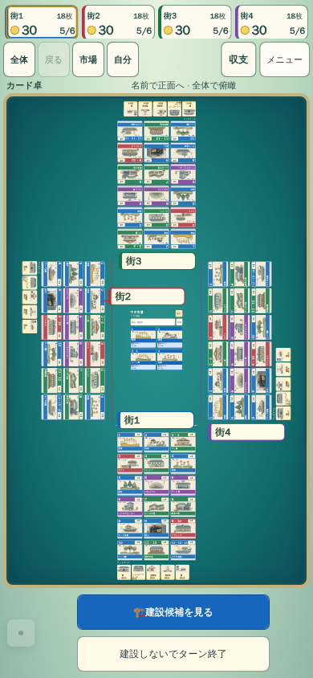
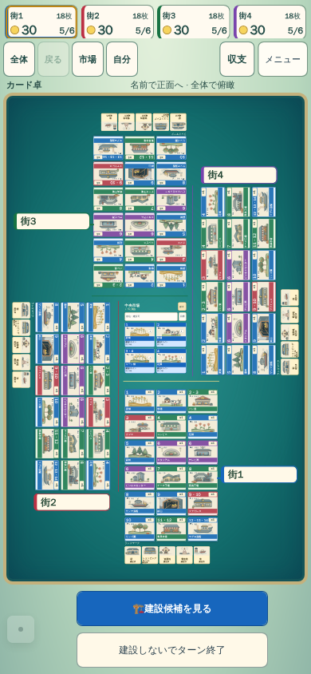

# 縦持ち密集4席の配置改善

fc69892dの390px実UI終盤を独立レビューし、縦長の卓の空白と小さな市場が残った。既存のdenseFour/pinwheel最適化が横持ち限定であるため、縦持ち密集4席に限る候補を用意した。

- 4人・縦持ち・正面閲覧外・いずれかの施設13種類以上だけ評価。
- 既存cross探索は変更せず、現在の最適crossを比較基準にする。
- pinwheel候補はside=[3,4,6,8]、end=[1,2,3,4]、market=[2,3]。現在と同じ実寸計測cacheと幾何関数を使用。
- 倍率が8%以上改善する場合だけ採用する。全施設・完成ランドマークと市場を保持し、四方向の角度、所有者、正本は変えない。
- 序盤・正面閲覧・5人以上は対象外。市場を専用dialogへ移した間は保存済みplanを保持。

倍率の仮説だけで採用しない。市場と席の位置関係、名前札、カード/ランドマーク包含・非重複、復帰、初期/再配置負荷を実ブラウザで比較する。pinwheelは街を市場の四隅へずらすため、視線が不自然になる可能性も独立レビューで確認する。

Node幾何2件、JS構文、ESLint、checkJsは成功。portrait追加診断では320/390×序盤/中盤/終盤の同一状態A/Bを1 contextずつ評価する。カード出目/枚数のCSS候補は両variantで共通で、比較差はlayoutソースだけ。新しい回帰結果や商用品質をまだ主張しない。

## 実測と独立レビュー

[abf05a8cの同一状態A/B](https://github.com/nao70161994/machikoro/actions/runs/41494249184)は320/390×序盤/中盤/終盤×変更前後の12条件で成功。カード128px/出目帯28pxの最終CSSを両variantで共通にし、比較差はlayout JSだけ。変更前JSは98addf35（portrait配置はfc69892dと同一）。

|条件|変更前→変更後のカード長辺|結果|
|---|---|---|
|320終盤|19.69→24.85px（約26.2%増）|pinwheelへ変更|
|390終盤|31.60→37.64px（約19.1%増）|pinwheelへ変更|
|320/390序盤・中盤|変更なし|4組の画像が完全一致|

[実測JSON](assets/nightly-quality/portrait-pinwheel-comparison.json)。各条件で全施設/完成ランドマーク・市場を保持、パネル/viewport内包含・非重複・pageErrors0・正本不変を確認。先行43f版（card124）の結果も残すが、最終版の値と混同しない。

独立画像レビューは、空白削減/カードと市場の拡大/複数列市場/所有者の対応を支持。札の明確な衝突や所有者誤認を招く配置は見つからなかった。最終重点15件では既存の320/390終盤・正面閲覧・復帰も初回成功。全景だけで施設名/効果を快適に読める状態にはまだ届かず、拡大閲覧が必要。商用品質到達や演出の滑らかさの証明とは分ける。
